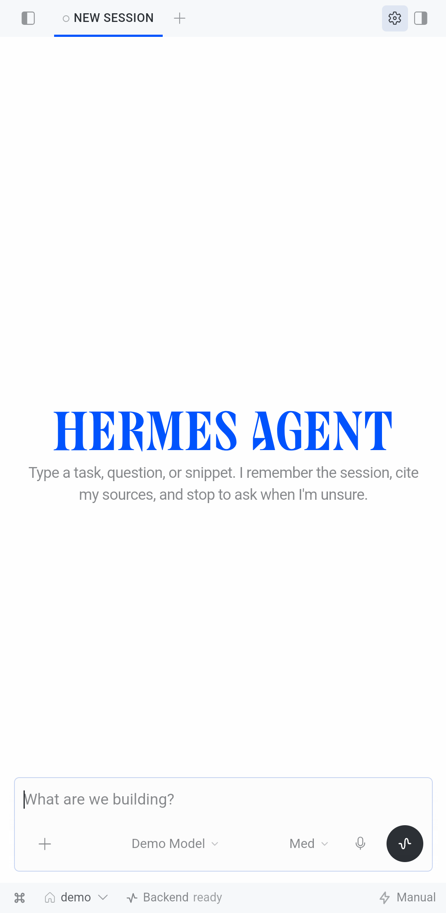
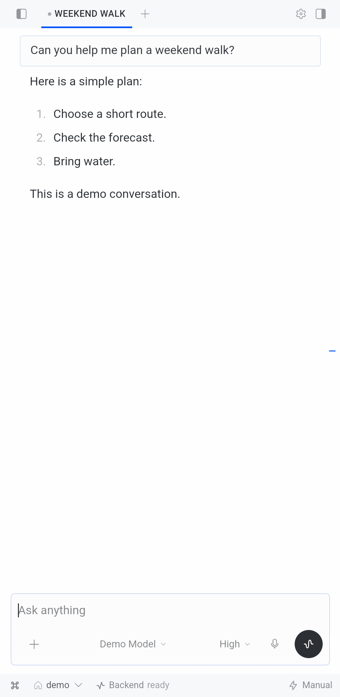
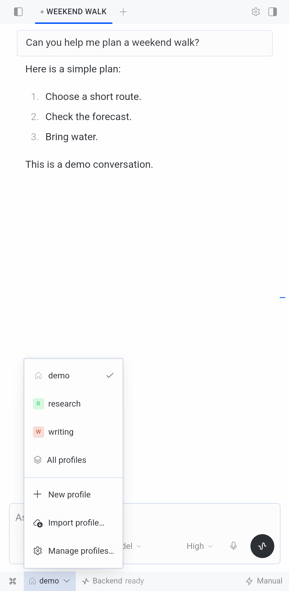
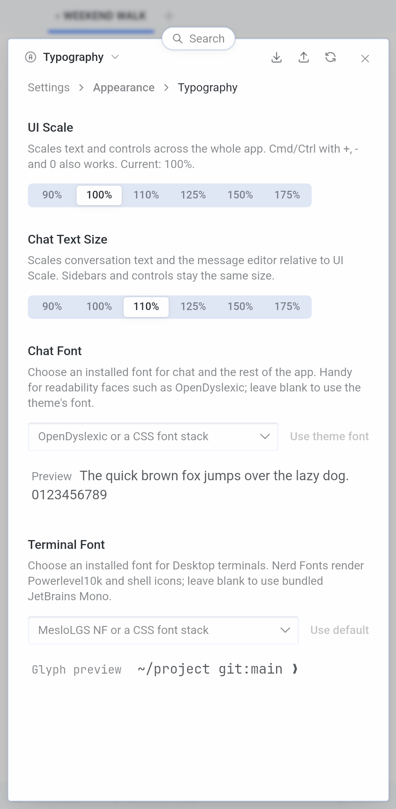
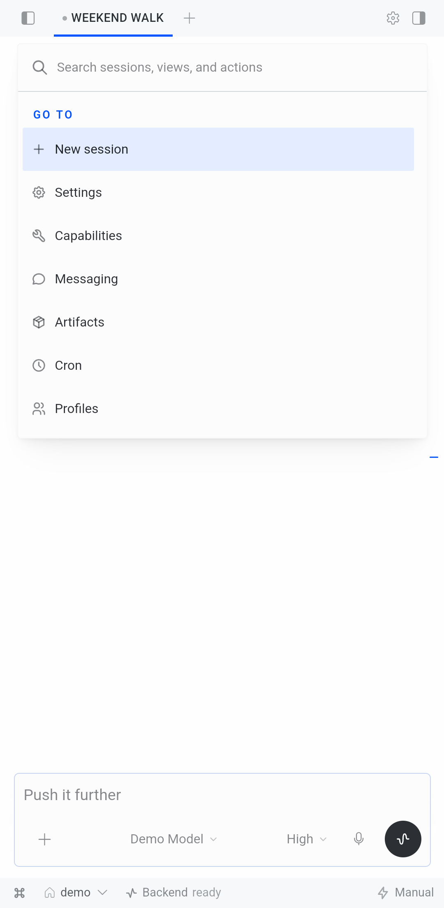
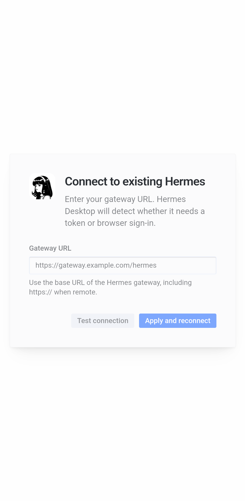

# Hermes Android

Unofficial Android client for [Hermes Agent](https://github.com/NousResearch/hermes-agent) by Nous Research.
It is the Hermes Desktop interface adapted for a phone. The agent does not run on the phone: the app connects to your own Hermes server.

**Experimental debug build. Not an official Nous Research app.**

[Releases](https://github.com/example-userilipia/hermes-android-app/releases) · [Changelog](CHANGELOG.md) · [Known limits](docs/COMPATIBILITY.md) · [Security notes](SECURITY.md) · [Report a bug](https://github.com/example-userilipia/hermes-android-app/issues)

| | | |
| --- | --- | --- |
|  |  |  |
|  |  |  |

Emulator screenshots with demo data.

## What is new in 0.3.1

Hermes Desktop v0.22.5 source, Codex Live voice calls, working "+" tabs, a native phone keyboard in the composer, and layout fixes. Details in the [changelog](CHANGELOG.md).

The newest APK on Releases is still **alpha.2**, which is older than this source. To get 0.3.1, build it from source.

## Requirements

- A Hermes server you run, reachable over HTTPS.
- Android 8 or later with a current Android System WebView. Checked on Android 17.
- For Codex Live voice calls: a server with Codex Live support. This is tested only on the author's patched server, not on stock Hermes.

## Install (alpha.2 APK)

1. Download the APK and `SHA256SUMS` from [Releases](https://github.com/example-userilipia/hermes-android-app/releases).
2. Verify the checksum: `sha256sum -c SHA256SUMS` (Windows: `certutil -hashfile <apk> SHA256`).
3. Sideload the APK. Updates keep your data only when the signing key matches the one you installed before.
4. Open the app, enter your gateway base URL (no path, for example `https://example.com`) and sign in through your server's browser flow. Keep the app in the foreground until sign-in finishes.

## Status

- Works: chat, sessions, profiles, "+" tabs, the compact phone layout, and Codex Live calls with a notification to end them.
- Checked on one real foldable phone: a voice call with two tasks, screen off for about 97 seconds. Not checked: a call with the screen off for over 2 minutes, and the first voice task in a brand-new "+" tab.
- Known gaps: background completion alerts, recovery after a failed first sign-in, full Desktop parity, a complete test against a stock Hermes server, wide and unfolded screens.
- Debug build: WebView debugging is on. Use a trusted device and server.

## Build from source

Needs Node 26, Python 3.11+, JDK 21 and the Android SDK. Details in [the build guide](docs/BUILDING.md).

```text
npm ci --ignore-scripts
npm run typecheck
npm run build
npm test -- --maxWorkers=2 --testTimeout=30000
npm run test:native
```

## License

Built from [Hermes Agent / Hermes Desktop](https://github.com/NousResearch/hermes-agent), MIT, Copyright (c) 2025 Nous Research.
Android integration: MIT, Pilipia.us. See [LICENSE](LICENSE), [LICENSE.upstream](LICENSE.upstream) and [third-party notices](THIRD_PARTY_NOTICES.md).
noVNC (MPL-2.0) and bundled fonts (OFL) keep their own licenses.

## Report a bug

Open an [issue](https://github.com/example-userilipia/hermes-android-app/issues) with the release, phone model, Android version and short steps.
Do not include secrets, chat text, your server address or account details.
